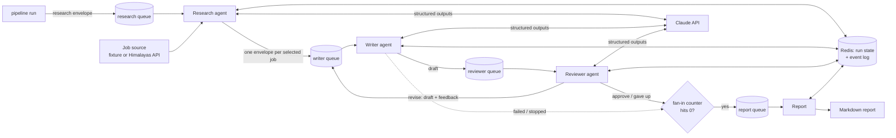

# Agent Pipeline

[](https://github.com/kuini-1/agent-pipeline/actions/workflows/ci.yml)

Three agents hand work to each other through Redis queues to turn a job search into reviewed applications. A **research** agent screens job postings against a candidate profile. A **writer** agent drafts a cover letter and resume bullets for each selected job. A **reviewer** agent approves each draft or sends it back with fixes. Every handoff is a typed message, every agent output is validated before it moves on, and each run ends with a Markdown report of everything that happened.

TypeScript, BullMQ on Redis, zod schemas, and the Claude API with structured outputs.

**Example output:** [a run with injected failures](examples/runs/demo-faults.md) · [a run stopped by its token budget](examples/runs/token-budget.md) · [a run whose worker was killed mid-step](examples/runs/worker-crash.md)

## What it does

- **Separate agents with one job each.** Research selects and rejects postings, the writer drafts, and the reviewer judges. They share no state. Each one gets everything it needs in the message it receives.
- **Queue-based handoffs.** Each agent has its own BullMQ queue. A handoff is an enqueue on the next agent's queue. Jobs fan out after research (one writer/reviewer branch per selected posting) and fan back in to a single report.
- **Validated output at every step.** Claude returns JSON in the agent's schema (structured outputs), zod checks it again, and an agent-specific check looks at the content. Invented claims, letters outside 180-320 words, placeholders, unknown job ids and jobs under the salary floor are all caught in code.
- **Repair before failing.** Invalid output goes back to the model with the exact errors, for up to two repair rounds. After that the job is marked failed, and the rest of the run carries on.
- **Stop conditions.** A run time limit, a run token budget, a per-step timeout, a cap on review rounds per job, and a cancel command.
- **Full history.** Every message, model call, validation error, retry and result goes into an append-only event log. The report is rendered from that log.
- **Runs offline.** A deterministic mock model, with a fault plan that breaks specific steps on purpose, runs the whole pipeline without an API key. CI runs it on every push.

## Architecture



Workers are ordinary Node processes. Run one with `pipeline run` (workers in-process) or start any number of `pipeline worker` processes on the same Redis. They share the queues, and BullMQ hands each message to one worker at a time.

Each worker step follows the same contract (`src/pipeline/workers.ts`):

1. Check the stop rules. If one applies, record the job as `stopped` and skip the model call.
2. Run the agent through `callValidated`, with repair rounds on invalid output.
3. Hand off: enqueue the next agent's envelope, or record the job's terminal result. The job that brings the fan-in counter to zero enqueues the report.

## Agent communication protocol

Every message is an `Envelope` (`src/protocol.ts`):

| Field | Meaning |
|---|---|
| `id` | `runId.to.jobRef.r<revision>`. Also the BullMQ job id, so sending the same message twice creates one job. |
| `runId` | The run this message belongs to. |
| `from`, `to` | `client`, `research`, `writer`, `reviewer` or `report`. |
| `jobRef` | The job posting this branch is about (absent for research and report). |
| `revision` | 0 for the first draft, +1 each time the reviewer sends a draft back. |
| `payload` | The request for the receiving agent: `ResearchRequest`, `WriteRequest`, `ReviewRequest` or `ReportRequest`. |

Payloads carry everything the receiving agent needs (profile, posting, research notes, the draft, the feedback), so any message can be inspected or replayed on its own. A real envelope from the demo run, from the reviewer back to the writer, with the long fields trimmed:

```json
{
  "id": "example-demo-faults.writer.fx-quillstack-llm-platform.r1",
  "runId": "example-demo-faults",
  "from": "reviewer",
  "to": "writer",
  "jobRef": "fx-quillstack-llm-platform",
  "revision": 1,
  "createdAt": "2026-11-23T05:52:45.754Z",
  "payload": {
    "profile": "{...candidate profile...}",
    "job": { "id": "fx-quillstack-llm-platform", "title": "LLM Platform Engineer", "company": "Quillstack", "salary_monthly_usd": 6500, "...": "..." },
    "research": { "job_id": "fx-quillstack-llm-platform", "match_score": 88, "key_requirements": ["LLM", "RAG", "TypeScript", "Go", "PostgreSQL"], "concerns": [] },
    "rank": 1,
    "previous": { "job_id": "fx-quillstack-llm-platform", "cover_letter": "Dear Quillstack team,\n\nI'm applying for the LLM Platform Engineer role...", "...": "..." },
    "feedback": {
      "job_id": "fx-quillstack-llm-platform",
      "verdict": "revise",
      "score": 6,
      "issues": [
        {
          "severity": "major",
          "issue": "The letter never says why Quillstack in particular; with the name swapped it could go to any employer.",
          "fix": "Add one sentence tied to something specific in the Quillstack posting."
        }
      ],
      "unsupported_claims": []
    }
  }
}
```

### Agent output schemas

Defined with zod in `src/schemas.ts` and sent to Claude as the structured-output JSON schema.

| Agent | Output | Checked in code (`src/agents/*`) |
|---|---|---|
| Research | `selected[]` (`job_id`, `match_score` 0-100, `why_match`, `key_requirements`, `concerns`) and `rejected[]` (`job_id`, `reason`) | Every input job appears exactly once; no unknown ids; at most `max_jobs` selected; no selected job below the salary floor |
| Writer | `job_id`, `cover_letter`, `resume_bullets[]`, `claims[]` (`claim`, `evidence`) | Right job id; 180-320 words; 3-5 bullets; no placeholders such as `[Hiring Manager]`; every claim's evidence is a whole profile field or an exact excerpt of at least 12 characters from one field |
| Reviewer | `job_id`, `verdict` (`approve` / `revise`), `score` 1-10, `issues[]` (`severity`, `issue`, `fix`), `unsupported_claims[]` | Right job id; score in range; no `approve` with blocker/major issues or unsupported claims; no `revise` without issues |

Inputs are `CandidateProfile` and `SearchCriteria` (see [`examples/profile.json`](examples/profile.json) and [`examples/criteria.json`](examples/criteria.json)). Postings are `JobPosting` ([`examples/jobs.json`](examples/jobs.json)).

### Run state in Redis

| Key | Type | Contents |
|---|---|---|
| `ap:run:<id>` | hash | config, request, status, token count, stop reason, timestamps |
| `ap:run:<id>:events` | list | the event log, one JSON object per event |
| `ap:run:<id>:jobs` | string | the postings the research step fetched |
| `ap:run:<id>:research` | string | the validated research output (checkpoint) |
| `ap:run:<id>:pending` | string | fan-in counter |
| `ap:run:<id>:results` | hash | job id to terminal result |
| `ap:run:<id>:report` | string | the rendered report |
| `ap:bull:*` | | BullMQ's queues |

Finished runs expire after seven days.

## Failure recovery

| What goes wrong | What happens | Where |
|---|---|---|
| Output isn't valid JSON, breaks the schema, or fails a content check | The model gets its output back with the list of errors and returns a corrected version. Up to 2 repair rounds, each logged. | `src/validate.ts` |
| Output is still invalid after the repair rounds | `InvalidOutputError`. The job is recorded as `failed` with the last errors, and the queue doesn't retry it, because the same prompt would most likely fail the same way. Other jobs continue. | `src/pipeline/workers.ts` |
| Output is cut off (`stop_reason: max_tokens`) | Treated as invalid output, with an error asking for shorter fields | `src/validate.ts` |
| The model declines (`stop_reason: refusal`) | The API first retries on a fallback model in the same call (server-side fallbacks). If that also declines, `RefusedError` fails the job without retries. | `src/model/anthropic.ts` |
| 400, 401, 403, 404, 413 or 422 from the API | Permanent: the job fails right away | `src/model/anthropic.ts` |
| 429, 5xx, 529, timeout, network error | The SDK retries twice. Then BullMQ retries the whole step with exponential backoff (3 deliveries by default). After the last one the job is recorded as `failed`. | `src/pipeline/workers.ts` |
| A worker dies mid-step | The job's lock expires, BullMQ's stalled-job check puts it back on the queue, and another worker (or the same one after a restart) runs it again. The report marks the step as restarted. | BullMQ |
| A step runs twice (redelivery after a crash) | Handoffs are idempotent. The next envelope has the same id, so BullMQ ignores the second add. A job's result is recorded with `HSETNX` and the fan-in counter is decremented in the same Lua script, so a job can't be counted twice. Research output is checkpointed, so a redelivered research step reuses its first selection instead of asking the model for a possibly different one. | `src/pipeline/store.ts` |
| The reviewer keeps asking for changes | After `--max-revisions` (default 2) the job ends as `gave_up`, with the last draft and review kept | `src/pipeline/workers.ts` |

### Stop conditions

Checked before every step:

- **Time limit** (`--time-limit`, default 10 min). Each step's timeout is also capped at the time left, so a slow call can't run past the deadline.
- **Token budget** (`--token-budget`, default 400,000), counted across all model calls in the run, repair rounds included.
- **Cancel** (`pipeline stop <run-id>`).

A stopped run still produces a report. Jobs that were stopped keep their last valid draft. The check runs when a step starts, so steps already running finish, and the budget can be overshot by the steps in flight. In [the token-budget example](examples/runs/token-budget.md), a 6,000-token budget ended at 7,675.

## Example run

[`examples/runs/demo-faults.md`](examples/runs/demo-faults.md) is the report of this command:

```bash
npm run pipeline -- run --profile examples/profile.json --criteria examples/criteria.json \
  --source fixture:examples/jobs.json --model mock --faults demo
```

It uses the fictional candidate in `examples/profile.json`, eight fictional postings, and the mock model, with the `demo` fault plan breaking a step in each branch:

| # | Job | What was injected | What the pipeline did | Result |
|---|---|---|---|---|
| 1 | LLM Platform Engineer, Quillstack | The first draft cites "a 15-person ML platform team at a Fortune 500 retailer", which isn't in the profile. Then the reviewer asks for a revision. | The evidence check rejected the claim and a repair round removed it. The reviewer's feedback went back to the writer as revision 1, which was approved. | approved, 9/10 |
| 2 | AI Engineer, Retrieval, Tidewater Analytics | The reviewer call fails with a 529 on its first delivery | BullMQ retried the step after the backoff, and it succeeded | approved, 8/10 |
| 3 | Applied AI Engineer, Brightloop | The writer is cut off at the token limit, then returns a 36-word letter with `[Hiring Manager]` in it, twice | Two repair rounds, then the job was marked failed with the validation errors. Jobs 1 and 2 were not affected. | failed |

Research rejected the other five postings: one below the salary floor, one US-only, one Europe-only, one weak match, and one that passed the filters but ranked fourth. The run made 11 model calls, 4 of which returned invalid output.

[`examples/runs/worker-crash.md`](examples/runs/worker-crash.md) comes from killing the worker container (`docker compose kill worker`) while all three writer steps were in progress, then starting it again. The run was about 6 s in when the worker was killed. The three writer steps were picked up again at 38.9 s, after BullMQ's default 30-second lock expired, and the run finished at 46.9 s with all three jobs approved. That run used the mock model with 4 s of artificial latency per call, so there was time to kill the worker.

**About the mock model.** The mock (`src/model/mock.ts`) is rule-based: keyword overlap for research, a template filled with profile facts for the writer, and fixed checks for the reviewer. It exists to exercise the queueing, validation and recovery code without an API key. Its letters show the data flow, not writing quality. The reports say so at the top.

**Not measured yet:** no run in this repository used the real Claude API, because no API key was available while building it. Token counts in the example reports are estimates (characters / 4), and there are no cost figures. The prompts in `src/agents/` are written for Claude but haven't been tuned against its real output.

## Running it

Needs Node 22+ and Redis.

```bash
npm ci
docker run -d --name redis -p 6379:6379 redis:7-alpine   # or any Redis
export REDIS_URL=redis://127.0.0.1:6379

# Offline, with the mock model and the planned failures
npm run pipeline -- run --profile examples/profile.json --criteria examples/criteria.json \
  --source fixture:examples/jobs.json --model mock --faults demo

# With Claude, on live postings from the Himalayas API
export ANTHROPIC_API_KEY=...
npm run pipeline -- run --profile my-profile.json --criteria examples/criteria.json --source himalayas
```

The report is saved to `runs/<run-id>.md`, which is gitignored. Use your own profile file for real applications and keep it out of the repository.

With Docker Compose (Redis with an append-only file, plus a worker you can scale):

```bash
docker compose up -d --scale worker=2 worker
docker compose run --rm cli run --profile examples/profile.json --criteria examples/criteria.json \
  --source fixture:examples/jobs.json --model mock --faults demo --no-workers   # prints the run id
docker compose run --rm cli report <run-id>
```

### CLI

```
pipeline run      --profile <file> --criteria <file> [options]   start a run and wait for its report
pipeline worker   [--concurrency 4]                              run the agent workers
pipeline status   <run-id>                                       status, tokens and results as JSON
pipeline report   <run-id> [--out file] [--render]               print or save the report
pipeline stop     <run-id>                                       cancel a run
pipeline list                                                    recent runs
```

`run` options: `--source fixture:<file>|himalayas`, `--model <claude-model-id>|mock`, `--effort low|medium|high|xhigh|max`, `--faults demo|<json>` (mock only), `--time-limit 10m`, `--token-budget 400000`, `--max-revisions 2`, `--max-repairs 2`, `--attempts 3`, `--backoff 2s`, `--step-timeout 3m`, `--run-id <id>`, `--out runs`, `--no-workers`. Run `pipeline help` for the full list.

Environment variables (see [`.env.example`](.env.example)): `REDIS_URL`, `ANTHROPIC_API_KEY`.

## Tests

```bash
npm run typecheck
REDIS_URL=redis://127.0.0.1:6379 npm test
```

32 tests. The unit tests cover the repair loop (with a scripted model), every content check, and the mock model's behaviour. The end-to-end tests run the real workers on real Redis, with the mock or a wrapped model. They cover:

- the demo run;
- the token budget and time limit stops;
- a refusal failing one job without retries;
- transient errors retried and then failing on the last delivery;
- reuse of the research checkpoint;
- fan-in counting under redelivery;
- duplicate sends collapsing to one queue job.

Without `REDIS_URL` the end-to-end tests are skipped. CI runs everything against a Redis service container, then runs the demo and checks its outcome.

## Project layout

```
src/
  protocol.ts          envelopes, request payloads, job results
  schemas.ts           zod schemas for inputs and agent outputs
  validate.ts          parse, check, repair loop
  agents/              research, writer, reviewer: prompt + schema + content check
  model/               Claude client, mock model, prices
  pipeline/            queues, workers, run state, run start/wait
  sources/jobs.ts      fixture files and the Himalayas API
  report.ts            Markdown report from the event log
  cli.ts
examples/              fictional profile, criteria, postings, and example reports
test/
```

## Model provider, APIs and licenses

- **Claude API**, through the official TypeScript SDK (`@anthropic-ai/sdk`, MIT). Default model `claude-opus-5-5` at effort `medium`, using structured outputs (`output_config.format`) and server-side refusal fallbacks (beta `server-side-fallback-2026-07-01`). Usage is billed to your Anthropic account under Anthropic's commercial terms. Prices in `src/model/pricing.ts` are list prices as of November 2026; update them if they change.
- **Himalayas public jobs API**, only when `--source himalayas` is used. The client sends at most three searches per run, one second apart. Fetched postings are stored with the run in Redis and expire with it. They are never committed. Check Himalayas' API terms before using it beyond personal job searching.
- **Example data** (the candidate, companies and postings in `examples/`) is fictional and was written for this project. Posting URLs point to `example.com`.
- **Dependencies:** BullMQ (MIT), ioredis (MIT), zod (MIT). The compose file uses the official `redis:7-alpine` image. Redis 7.4 and later are dual-licensed RSALv2/SSPLv1, which allows self-hosting like this. A BSD-licensed fork such as Valkey should also work, but hasn't been tested here.

## Limitations

- The prompts have only been exercised by the mock model. Expect to tune them on the first real runs.
- The evidence check proves that each listed claim is quoted from the profile, not that the letter lists every claim it makes. The reviewer is the second line of defense for claims the writer didn't list.
- The token budget is checked between steps, so it can be overshot by the steps already running.
- A crashed worker's steps wait for the lock to expire (30 s by default) before they run again.
- The job source is plain code, not a tool the research agent calls. That keeps fetching deterministic and testable, but the agent can't decide to search again with different terms.

## Lessons learned

- **The schema is the easy part.** Structured outputs make shape errors rare. The failures that matter pass the schema: an invented achievement, a letter that's too short, a `[Hiring Manager]` placeholder. They need content checks in code, written per agent. The first full demo run failed all three jobs, because the mock's template letters came out at 172-178 words and the word-count check caught it.
- **Retry, repair and fail are three different responses.** Invalid output needs a repair round: the model sees the specific errors, which a blind retry doesn't tell it. Retrying the same call through the queue would pay for the same mistake up to three times. Network errors and overloads are the opposite: the call was fine, so retry it as is. Telling the two apart (`PermanentError` versus everything else) is what keeps the retry policy cheap.
- **At-least-once delivery means every handoff has to be idempotent.** Using the envelope id as the queue job id, recording results with `HSETNX`, and decrementing the fan-in counter in the same Lua script made redelivered steps harmless. The research checkpoint matters too: without it, a redelivered research step could pick a different set of jobs than the writers already working on the first set.
- **Text matching needs word boundaries.** Plain substring checks are too loose for short strings. For evidence, a two-letter fragment like "go" can sit inside unrelated text, but "Go" on its own is a real skill in the profile. Hence the rule: a whole field, or an excerpt of at least 12 characters. The mock's region check had the same problem with a live Himalayas fetch: it counted a job restricted to a country list that included "Malaysia" as open to Asia, because the word contains "asia".
- **Kill the worker, don't just test the happy path.** Killing a worker mid-step was the only way to see what crash recovery actually looks like: a 30-second gap, then the step starting again with the same delivery number. That's why the report detects restarts explicitly instead of showing a confusing second "started".
